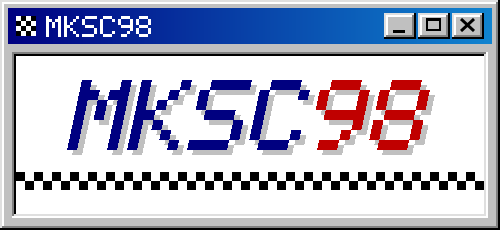

<p align="center">
  
</p>

# MKSC98

An unofficial, cut-down port of the classic game from
[MKSC Neo](https://github.com/arcanite24/mksc-neo) to **Windows 98 SE** on
period hardware. It keeps MKSC Neo's original software mode-7 renderer, menus,
sprites, game logic and sound, played on the keyboard, and drops everything a
DirectX 7-era PC can't carry. The picture is the original 240x160 at the GBA's
59.73 Hz, scaled by whole numbers so pixels stay sharp. In fullscreen it can
grow to fill a 5:4, 4:3 or 16:9 screen without stretching.

MKSC98 is not affiliated with or endorsed by the MKSC Neo authors or Nintendo.
Please don't report MKSC98 problems to MKSC Neo.

Developed in a VMware Windows 98 SE guest and tested on a real Athlon 900 /
Radeon 7200 / Sound Blaster PCI machine at 1280x1024.

## Requirements

**Computer**
- Windows 98 SE (it also runs on later Windows)
- A CPU without SSE is fine: the target is a ~900 MHz Athlon, which holds full
  speed at 1280x1024
- DirectX 7 and a DirectX 7 graphics card for sharp hardware scaling.
  DirectDraw and plain GDI are used as fallbacks.
- Any DirectSound or waveOut sound card
- About 40 MB of disk space for the converted game data

No DLLs or installers are needed. `mksc98.exe` is one statically linked file
that imports only `kernel32`, `user32`, `gdi32`, `winmm` and `msvcrt`;
`ddraw.dll` and `dsound.dll` are loaded at run time when present.

**ROM.** No game content is included. You need your own legally obtained
cartridge dump of the US release:

| | |
|---|---|
| File name | `Mario Kart - Super Circuit (USA).gba` (must match exactly) |
| SHA-1 | `9d327c030c3e2d9007990518594f70c3340ac56f` |
| Format | Unzipped `.gba` |

Other regions, revisions and zipped ROMs are not supported. Never commit or
publish the ROM, `game.pack`, saves or screenshots taken from the game.

## Running it

1. Copy `mksc98.exe` to a folder on the Windows 98 machine, for example
   `C:\MKSC`.
2. Put the ROM in the same folder.
3. Run `mksc98.exe`. The first start converts the ROM into `game.pack`
   (about 38 MB) next to the exe. Later starts only check it.

Settings, records, ghosts, Grand Prix progress and `mksc98.log` are saved in
the same folder. The log is rewritten on every start; if something goes
wrong, it says why.

Recommended on a 1280x1024 screen:

```
mksc98.exe --fullscreen --aspect fill
```

Or turn on **Fullscreen** and **Aspect Ratio: Fill** once in Options; the game
then starts that way.

### Controls (keyboard only)

| Action | Key |
|---|---|
| Steer / move in menus | Arrow keys |
| Accelerate / confirm | Z (Enter also confirms) |
| Back in menus (does nothing during a race) | X |
| Brake | Down |
| Hop / drift | Left Shift |
| Item (aim with Up / Down) | C |
| Pause / start (leave a race from the pause menu) | Space or P |
| Quit the game | Esc, or **Quit** at the bottom of the title menu |

Driving keys can be rebound in Options. Esc always quits.

### Command-line options

```
--scale N          window size as a multiple of 240x160 (1..8); otherwise the saved Options value
--fullscreen       fill the screen at the desktop's own resolution and colour depth; the
                   picture is the largest whole multiple that fits, centred on black
--windowed         start in a window even if Fullscreen is saved in Options
--aspect R         for this launch: original, fill (see TECHNICAL.md), or a fixed
                   shape W:H from 3:2 to 32:5
--tall N           races get N extra rows of sky on top (1..96) whatever the aspect setting
--fullscreen-640   switch the display to 640x480 16-bit instead (2x picture)
--no-flip          fullscreen Direct3D copies the picture to the screen instead of page-flipping
--sync-flip        fullscreen: wait inside the flip for the card to finish drawing
--ddraw            do not use Direct3D: DirectDraw stretch blit (some cards smooth it)
--gdi              use neither (GDI StretchDIBits)
--soft-scale       scale on the CPU and blit 1:1 instead of a hardware stretch blit
--no-audio         do not open the sound device
--waveout          sound through waveOut instead of a DirectSound looping buffer
--fps              log pictures per second every 5 seconds
```

How `--aspect` and `--tall` widen and heighten the picture without stretching
it, and what Fill picks for common screens, is explained under
[Picture shapes](TECHNICAL.md#picture-shapes).

### In-game Options

Title menu > Options lists only what works in this port:

| Option | Effect |
|---|---|
| Window Scale | Resizes the window (applies when leaving fullscreen if set while fullscreen). |
| Fullscreen | Desktop-resolution fullscreen, same as `--fullscreen`. |
| Display Scaling | Integer: whole-number scale with black borders (default, pixel perfect). The other setting stretches to fit. |
| Aspect Ratio | **Original** (240x160) or **Fill**. Fill applies in fullscreen; in a window the picture is the original. |
| Master Volume | 0 to 100. |
| Key Bindings | Z or Enter opens the eight keys; Tab resets the selected key. |
| Fast Menus, Input Display, Mirror Mode, Fix Doppler Bug | As in MKSC Neo. |

The title menu's Multiplayer row answers "unavailable".

## What's left out

3D renderer and 3D courses, SDL_GPU / OpenGL / GLES, HD-2D effects, modern
menus, Lua and mods, the mod store, Mario Kart DS / 64 imports, the course
editor, split-screen and local multiplayer, internal supersampling,
interpolation and unlocked frame rates, high-detail artwork, controllers,
rumble, touch, file dialogs, zipped ROMs, Android and web builds. MKSC Neo has
all of these.

## Building

MKSC98 is cross-compiled from Linux or WSL (Windows Subsystem for Linux) with
32-bit MinGW. On Ubuntu or Debian (`build-essential` is only needed for the
host reference build):

```sh
sudo apt install gcc-mingw-w64-i686 cmake ninja-build python3 git build-essential
git clone https://github.com/Chad414/mksc98.git
cd mksc98/win98
./build.sh            # out/mksc98.exe, then the post-build checks
./build.sh host       # headless reference build for the build machine
```

The exe is compiled with `-march=i686 -mtune=athlon-tbird -mno-sse -mno-sse2
-mfpmath=387`, static libgcc and the CRT startup code, linking against
`msvcrt.dll` (Ubuntu's `i686-w64-mingw32-gcc` 13 was used).

`check_exe.sh` runs after every build and fails it if:
- the exe imports anything not exported by a real Windows 98 SE DLL (the
  lists in `win98/exports/` were taken from a Win98 SE install with
  `fetch_exports.ps1`), or
- its disassembly contains any SSE/SSE2/AVX instruction.

The scripted test mode, cross-build hash comparison, Windows 98 VM helpers,
measured results and an overview of the port's internals are in
[TECHNICAL.md](TECHNICAL.md).

## Credits and licence

The game is [MKSC Neo](https://github.com/arcanite24/mksc-neo) by arcanite24:
the simulation, physics, AI, items, renderer, menus, sound and ROM importer
all come from there, and this port compiles it largely unchanged. MKSC Neo in
turn credits the [aplerdal/mksc](https://github.com/aplerdal/mksc)
decompilation for recovering the original game's behaviour. Third-party fonts
are listed in [LICENSE-NOTICE.md](LICENSE-NOTICE.md).

The port's own work in `win98/` and its changes to MKSC Neo's files are under
the MIT licence in [win98/LICENSE](win98/LICENSE). Everything else stays under
MKSC Neo's own terms.

MKSC98 is an unofficial fan project, not affiliated with, endorsed by or
supported by the MKSC Neo authors or Nintendo. Mario Kart and Mario Kart:
Super Circuit are trademarks of Nintendo. No Nintendo code, art, sound or ROM
data is included; you need your own legally obtained copy of the game.
